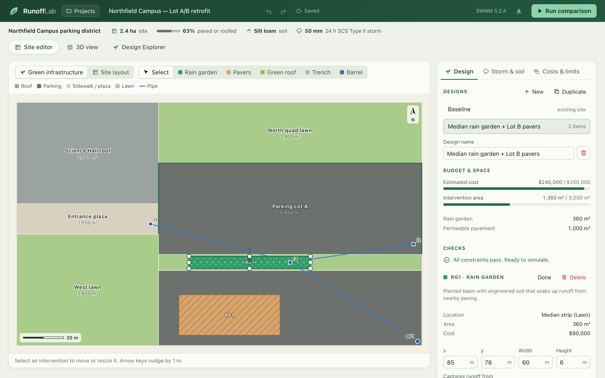
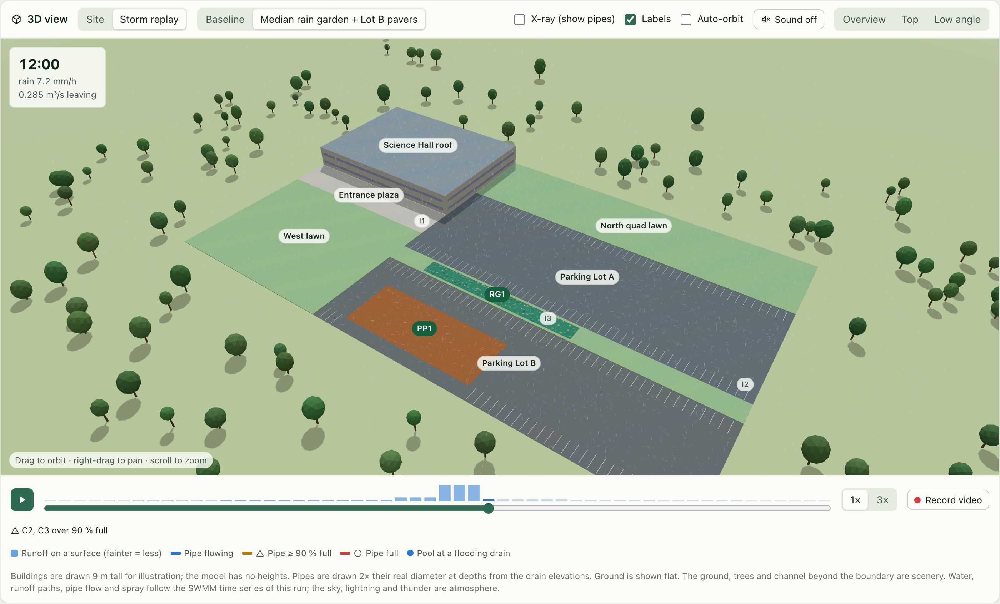
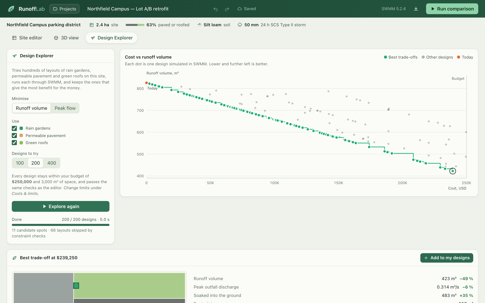
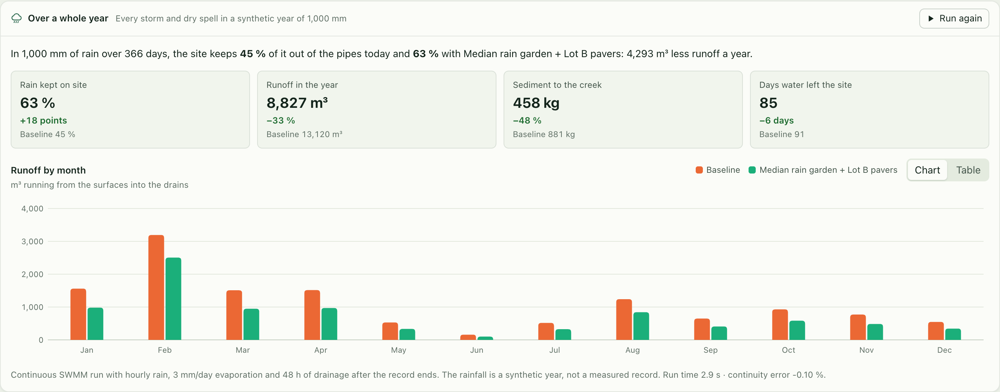
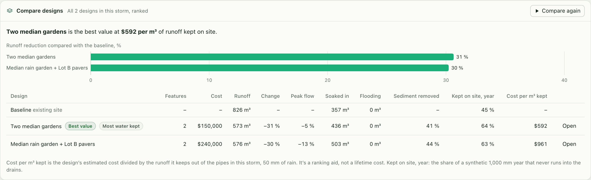

# RunoffLab — Stormwater & Green Infrastructure Optimizer

RunoffLab models how green infrastructure (rain gardens, permeable pavement,
green roofs, infiltration trenches and cisterns) changes stormwater runoff and
water quality on developed sites. It does this with **EPA SWMM 5.2**, run
locally through PySWMM. Every reported number comes from a SWMM run; there are
no hand-tuned formulas. It needs no API keys, accounts, or internet connection
at runtime.

> **Status: Milestones 1–5 complete.** Simulation backend, constraint checks,
> HTTP API, web workspace with a site builder, five kinds of green
> infrastructure, water quality, SQLite projects, the Design Explorer
> optimizer, design comparison, year-long simulation, a 3D storm replay with
> sound and video export, what-if analysis and PDF reports, with 128 automated
> tests and Docker deployment. See the [write-up](docs/WRITEUP.md) and [demo script](docs/DEMO.md).

| | |
|---|---|
|  |  |
| **Site editor.** Draw green infrastructure on the plan; checks run as you edit. | **Results.** Baseline vs design from SWMM: runoff, peak flow, where the rain went. |
|  |  |
| **3D storm replay.** Rain, runoff, pipe flow and spray from the SWMM time series. | **Design Explorer.** Hundreds of layouts run through SWMM; the best trade-offs highlighted. |
|  |  |
| **A whole year.** Continuous SWMM through a year of rain: share kept on site, runoff by month. | **Compare designs.** Every design ranked by value, with sediment removal and the year. |

A [short video of the 3D storm replay](docs/media/storm-replay.mp4) was recorded
with the app's own **Record video** button.

## Quick start with Docker

```bash
docker compose up --build      # then open http://localhost:3000
```

Projects are kept in a Docker volume, so they survive restarts. To run
without Docker, or to work on the code, see below. To put it online, see
[Deploying](docs/DEPLOY.md).

## What works today

- **SWMM integration, verified.** SWMM 5.2.4 runs through PySWMM 2.2.0.
  A test checks the engine against a hand calculation (1 ha roof, 30 mm storm).
  Runoff equals rain minus depression storage to within 0.05 mm, and the
  peak flow matches the steady-state value.
- **Site model.** Roofs, parking, sidewalks and lawns are drawn as rectangles,
  draining to catch basins and a pipe network with an outfall. Any site can be
  drawn in the app (see **Site layout** below), not just the sample campus.
- **Green infrastructure** as native SWMM LID controls:
  - rain gardens (`RG`), which capture runoff from an adjacent impervious
    surface;
  - permeable pavement (`PP`), with optional run-on;
  - green roofs (`GR`), planted on a roof;
  - infiltration trenches (`IT`), stone-filled trenches that soak runoff from
    nearby paving into the ground;
  - rain barrels and cisterns (`RB`), which store roof runoff and empty
    slowly after the storm.
  Draw them with R, P, G, T and B; each has its own settings, cost and look
  in the plan and in 3D.
- **Water quality.** Sediment (TSS) and phosphorus wash off each surface at
  typical urban concentrations; SWMM tracks what green infrastructure keeps
  out of the creek. Results show kilograms leaving the site, the % removed and
  progress against the 80 % TSS-removal target many permits use (the sample
  design removes 44 %). It's also in Compare designs and the PDF report.
- **Year-long simulation.** Beyond the single design storm, SWMM runs
  continuously through a year of hourly rain (a synthetic year scaled to your
  annual rainfall, or a CSV record you import) and reports the share of the
  year's rain kept on site, yearly runoff and sediment, days with outflow and
  runoff by month. On the sample site, the design keeps 63 % of a 1,000 mm year
  on site against 45 % today. It's also in Compare designs and the PDF report.
- **Constraint enforcement.** Designs that break a rule are refused before
  SWMM runs: footprints outside their host surface, overlaps, the wrong host
  surface type, over-capture, loading ratios, budget, and available area.
- **Results.** Water balance (mm and m³), peak outfall discharge, node
  flooding and surcharge, per-LID water balance, and 5-minute time series
  for playback. Each result records the SWMM and PySWMM versions and the
  SHA-256 of the exact input file, so it can be reproduced.
- **Bundled sample site.** A fictional 2.4 ha campus block with a starter
  design.

### Sample result (reproducible: `pytest tests/test_engine.py`)

The sample site under a 50 mm, 24 h SCS Type II design storm on silt loam:

| | Baseline | Median rain garden + Lot B pavers |
|---|---:|---:|
| Runoff volume | 826 m³ | 576 m³ (−30 %) |
| Peak outfall discharge | 0.335 m³/s | 0.291 m³/s (−13 %) |
| Infiltration | 357 m³ | 503 m³ |
| Intervention area / cost | — | 1,360 m² / USD 240,000 (illustrative unit costs) |

These numbers come from a fictional site with illustrative unit costs. They
show what the tool does; they are not a claim about any real campus.

## Running the backend

```bash
cd backend
python3 -m venv .venv && .venv/bin/pip install -e ".[dev]"     # Python 3.11+
.venv/bin/python -m pytest                                     # 76 tests, ~11 s
.venv/bin/uvicorn runofflab.api.app:app --reload               # http://localhost:8000/docs
```

`pyswmm` installs the SWMM engine as a prebuilt wheel, so there is nothing
else to download or compile.

## Running the web interface

With the backend running on port 8000:

```bash
cd frontend
npm install
npm run dev        # http://localhost:3000
```

The Next.js app proxies `/api/*` to the backend (override the target with
`RUNOFFLAB_API_URL`). It has:

- an SVG site editor: draw, move and resize rain gardens and permeable
  pavement, with 1 m snapping, undo/redo and keyboard shortcuts
  (`R`/`P`/`V` tools, arrows nudge, `Delete`, `⌘Z`, `⌘↵` to run);
- live constraint checks, with budget and area meters, as you edit;
- storm, soil, cost and constraint settings;
- baseline vs proposed results: KPI deltas, outfall hydrograph with rainfall
  (chart or table), water balance, per-LID performance and node results.

### Site layout

Model your own site, not just the sample. **Projects → New blank site** starts
an empty lot (a lawn with one drain piped to an outfall); the **Site layout**
switch above any plan edits the site itself:

- **Surface** (`S`): drag to draw a roof, parking lot, road, sidewalk, lawn or
  planted bed. A new surface replaces whatever it's drawn over, so the lawn is
  cut around a new building and nothing overlaps.
- **Drain** (`D`): click to place a catch basin. New surfaces drain to the
  nearest one; change it in the sidebar.
- **Pipe** (`C`): drag from a drain to the next one downstream, ending at the
  outfall. Lengths follow the plan, and a newly placed drain is set at the
  depth that gives its pipe a 0.5 % fall.
- **Select** (`V`): move or resize surfaces, drag drains and the outfall, and
  edit names, types, slopes, elevations and pipe sizes in the sidebar.
  Delete and arrow keys work, and every edit can be undone.

The checks cover the whole network: overlaps, anything outside the site, a
drain with no pipe path to the outfall, pipes that run uphill (with a one-click
fix), and land with no surface on it. Everything else (SWMM runs, the Design
Explorer, the 3D view and PDF reports) works on the site you draw.

### Design Explorer, storm playback and what-if

- **Design Explorer** (the second view): searches hundreds of rain-garden and
  permeable-pavement layouts, runs each one through SWMM in parallel worker
  processes, and plots cost against runoff volume or peak flow. The best
  trade-offs (the Pareto front) are highlighted; any design can be inspected
  and added to the project in one click. 200 designs take about 4 s. On the
  sample site it finds a USD 205,000 layout with 481 m³ of runoff, against
  USD 240,000 and 576 m³ for the hand-drawn sample design.
- **Storm playback** (in the results): replays the storm on the site plan
  step by step, for the baseline and the design side by side. Surfaces shade
  by how much runoff they shed, pipes thicken and change colour as they fill,
  and flooding drains are ringed.
- **3D view** (the "3D view" tab): the same site in three.js, with buildings,
  sunken rain gardens, permeable pavers, and the drains and pipes underground
  (X-ray shows them). Hover anything for details; click a rain garden or paver
  to select it in the editor. After a run, **Storm replay** plays the SWMM time
  series in 3D: rain falls at the recorded intensity, surfaces tint with
  runoff, pipes turn amber or red as they fill, flooding drains pool, and a
  stream leaves the outfall. **Runoff paths** show water running across each
  surface to its drain, or into the rain garden that captures it, at the rate
  SWMM reports for that surface; roof water runs to the edge and drops.
  **Record video** saves the replay (with sound, if on) as an MP4 or WebM with
  the storm clock and a caption, ready for a presentation. The site sits in a
  landscape of meadow and trees, with a channel carrying the outfall's water
  away; that scenery is not part of the model. Playback glides between SWMM's 5-minute reports,
  water bands slide through the pipes faster as flow rises, and raindrop
  ripples appear only on surfaces that are shedding water. **Sound** (off until
  you turn it on; synthesised in the browser, no audio files) follows the run:
  rain hiss, a downpour roar, the rush of water leaving the site, and soft
  tones when a pipe runs full or a drain floods. The darkening sky, lightning
  and thunder are atmosphere, shown only in heavy rain (25 mm/h and up), and
  are switched off with reduced motion. Building heights are illustrative
  (the model has none) and pipes are drawn at twice their diameter.
- **Compare designs** (in the results): runs the baseline and every design
  through SWMM in the same storm and ranks them by runoff kept on site, with
  peak flow, flooding, sediment removed, cost and **cost per m³ kept**.
  **Add a year of rainfall** adds each design's share of a whole year's rain
  kept on site. The best value and the
  design that keeps the most water are flagged, designs that fail a check are
  listed (not run), and **Open** jumps to any of them.
- **What-if analysis** (in the results): runs the baseline and the design
  under smaller and bigger storms and with slower infiltration (compaction,
  clogging), 14 SWMM runs in under a second.

Projects are saved to a local SQLite database (`backend/runofflab.db`; set
`RUNOFFLAB_DB` to use another file). Edits autosave about a second after you
stop typing. The **Projects** menu creates, duplicates, imports, opens and
deletes projects, and the URL (`?project=<id>`) links to the open one. If the
same project is edited in two tabs, the second save is refused rather than
overwriting, and you choose which version to keep. Projects can still be
exported as JSON.

### PDF reports

After a comparison run, **PDF report** downloads a report for the design:
a summary with a site plan, the storm response, the water balance, each
intervention's performance, water quality, the drainage network, a year of
rainfall (share kept on site and runoff by month), the what-if cases, Design
Explorer trade-offs (when the exploration used the same inputs), every
assumption with its source, and the SWMM versions and input hashes that
reproduce the numbers. It is generated locally with ReportLab; the backend
re-runs SWMM to build it, so the report never shows stale results.

## Tests

```bash
cd backend && .venv/bin/python -m pytest   # 76 backend tests: engine, every LID type, water quality, year-long runs, validation, API, storage, optimizer, report
cd frontend && npm test                    # 39 unit tests: geometry, site builder, undo/redo, 3D scene, rain and runoff
cd frontend && npm run test:e2e            # 13 browser tests of the main flows, including 3D, video, comparison and year-long runs
```

The browser tests start their own backend on port 8100 with a throwaway
database and their own frontend build on port 3100, so they never touch your
projects or a dev server you have running. They drive your installed Google
Chrome, so there is no browser download.

## Docs

- [Write-up](docs/WRITEUP.md): the project as a case study
- [Demo script](docs/DEMO.md): a three-minute walkthrough
- [Deploying](docs/DEPLOY.md): Docker, a VPS, Render or Fly.io
- [Architecture](docs/ARCHITECTURE.md)
- [Methodology & assumptions](docs/METHODOLOGY.md)

## Roadmap

1. ✅ **Foundation**: verify SWMM, build the domain model, INP generator,
   runner, validation and API, with tests.
2. ✅ **Core product**: Next.js workspace, SVG site editor, scenario settings,
   baseline vs proposed results, and SQLite projects.
3. ✅ **Standout features**: storm playback, the Design Explorer optimizer
   (Pareto front), and what-if analysis.
4. ✅ **Polish**: PDF reports, UX pass, and frontend tests.
5. ✅ **Portfolio**: screenshots, a demo video, a demo script, a write-up,
   and Docker deployment.

Possible next steps: ground elevations instead of a flat site,
polygon surfaces, lifecycle costs, and user accounts for a public deployment.
