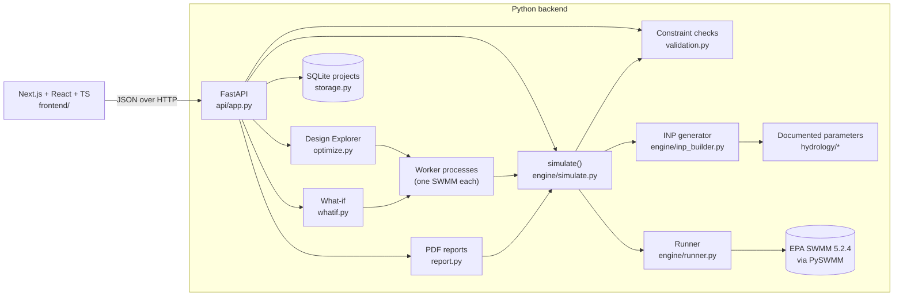

# Architecture

## Layers

| Layer | Module | Responsibility |
|---|---|---|
| Domain model | `models/project.py`, `models/results.py` | Pydantic schemas: the single source of truth for project files, API bodies and saved results |
| Parameters | `hydrology/` | Soil, surface, rainfall and water-quality (`quality.py`) assumptions, each with a cited source |
| Validation | `validation.py` | Geometry and budget constraints; returns structured `Issue`s |
| Model generation | `engine/inp_builder.py` | Pure function: (site, design, scenario) → SWMM `.inp` text |
| Execution | `engine/runner.py` | Runs SWMM in a temp dir, parses stats and the binary `.out` file |
| Optimizer | `optimize.py` | Spot generation, genome → design, Pareto search as a background job polled by the UI |
| Reports | `report.py` | PDF built with ReportLab from fresh SWMM runs: tables, site plan and charts drawn as vector graphics |
| What-if | `whatif.py` | Re-runs baseline and design under storm and infiltration variations |
| Storage | `storage.py` | SQLite project store: whole-project JSON documents with a version counter |
| API | `api/app.py` | Thin HTTP layer; maps validation failures to 422 and engine failures to 500 with SWMM's message |

On the frontend, `lib/lids.ts` describes every kind of green infrastructure
(name, colours, allowed hosts, what it captures) for the editor, sidebar,
results and 3D view; `lib/siteBuilder.ts` holds the site-layout editing
rules; `lib/scene3d.ts` builds the three.js scene from a site and a SWMM
result without touching WebGL, so it is unit-tested in Node; and
`lib/stormAudio.ts` synthesises the replay's sound with the Web Audio API.

Deployment is two Docker images (`backend/Dockerfile`, `frontend/Dockerfile`)
run together by `docker-compose.yml`; see [Deploying](DEPLOY.md).

## Key decisions

- **Rectangles, not GIS polygons.** Surfaces and interventions are
  axis-aligned rectangles in metres. This keeps overlap and containment
  checks exact and the SVG editor simple. It is plenty for parking lots and
  campus blocks, and the model can be extended later.
- **One SWMM subcatchment per surface.** Each surface maps directly to one
  subcatchment, so results line up with what the user drew.
- **LIDs as SWMM LID controls**, with one control per intervention. Each
  intervention gets its own geometry and its own water balance.
- **Validate before simulating.** An infeasible design never reaches SWMM,
  so the UI can never show results for a layout that breaks the rules.
- **Projects are stored as whole JSON documents.** The saved row is the
  same `Project` document the API accepts, so there is no mapping layer to
  drift. Each save names the version it started from; a mismatch returns 409,
  so two tabs can't silently overwrite each other. Drafts that break
  constraints can still be saved, since validation guards simulation, not
  storage.
- **SWMM is single-instance per process.** The runner holds a lock, so the
  Design Explorer and what-if analysis evaluate candidates on a shared pool of
  worker processes (up to 4), each with its own SWMM. On the sample site 200
  designs take about 4 s. Constraint checks run first in the API process, so
  infeasible layouts never cost a SWMM run.
- **Reports re-simulate.** `POST /api/report` takes the project and a design
  id and runs SWMM again rather than trusting numbers sent by the browser, so
  a report always matches its stated inputs. Design Explorer results are only
  included when the exploration used the same site, costs, limits and storm.
- **Tests at three levels.** pytest covers the backend; Vitest covers the
  frontend's pure logic (geometry, the undo/redo reducer, formatting);
  Playwright drives the real app in Chrome against an isolated backend and
  database.
- **Optimizer runs are background jobs.** `POST /api/explore` starts a job and
  returns its id; the UI polls `GET /api/explore/{id}?since=n` for new points
  and draws the front as it grows. Jobs live in memory, since explorations
  are cheap to rerun.
